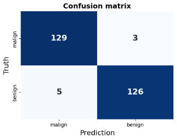

# Croissant

**Breast cancer detection on ultrasound images with deep learning (PyTorch Lightning).**

Croissant classifies breast ultrasound images as **malignant** or **benign**. It was built during a 5-month research internship at the [Pontificia Universidad Católica del Perú](https://www.pucp.edu.pe/) (Lima, May–Sep 2025), as part of a project on AI techniques applied to ultrasound data.

The project benchmarks several CNN architectures and loss functions, and explores segmentation and late fusion of image and lesion mask.

Dataset: [Breast Ultrasound Images Dataset](https://www.kaggle.com/datasets/aryashah2k/breast-ultrasound-images-dataset) (Kaggle).

## Results

Best model: **DenseNet + Binary Cross-Entropy**, image only (no tabular data), on a held-out test set of 263 images.

| Metric | Score |
|---|---|
| Accuracy | **97.0 %** |
| Sensitivity (recall, malignant) | **97.7 %** |
| Specificity | **96.2 %** |
| Test loss | 0.2 |

<p align="center">
  
</p>

Only 3 malignant cases out of 132 were missed (false negatives), which is the error that matters most in a screening context.

## Approach

- **Models compared:** ResNet, ResNet-101, MobileNet, Inception, VGG16, DenseNet and an MVSA-DenseNet variant, with pre-trained weights and fine-tuning.
- **Losses compared:** cross-entropy (with class weights and label smoothing), binary cross-entropy, focal loss, BCE + Dice for segmentation.
- **Training:** AdamW (lr = 1e-4), batch size 16, `ReduceLROnPlateau` scheduler, early stopping on validation loss, up to 50 epochs.
- **Metrics:** accuracy, recall and specificity logged at each epoch for train / validation / test, plus a confusion matrix on the test set.
- **Segmentation & fusion** (`image_mask/`): lesion masks, data augmentation and a late-fusion model combining image and mask branches.

## Quick start

```bash
pip install -r requirements.txt
cd only_pic_lightning/train
python train_light_D_CE.py
```

Logs and checkpoints are written to `lightning_logs_densenet_CE/`.

## Project structure

```
Croissant/
├── only_pic_lightning/      # Main classification pipeline (recommended)
│   ├── dataframe.py             # Builds the image / label DataFrame
│   ├── dataframe_transform.py   # Preprocessing and augmentations
│   └── train/
│       ├── train_light_D_CE.py  # Main training script (DenseNet + BCE)
│       ├── model_lightning.py   # LightningModules (binary, multiclass, patient-level)
│       ├── models.py            # Architectures (ResNet, MobileNet, DenseNet, VGG…)
│       ├── loss.py              # Loss functions
│       ├── dataloader.py        # Train / val / test loaders
│       └── confusion_matrix.py  # Confusion matrix plot
├── image_mask/              # Segmentation and late fusion
│   ├── dataframe/               # Mask DataFrames, normalization coefficients, augmentation
│   ├── dataset/organizing.ipynb # Dataset organization
│   └── model/
│       ├── train_3.py           # Segmentation training script (recommended version)
│       ├── LateFusionLightning.py, LF_models.py  # Late fusion model
│       └── dataloader.py, loss.py
├── only_pic/                # First experiments (plain PyTorch)
├── pyra/                    # Exploratory scripts
├── General/                 # Work in progress: unified models and losses
└── requirements.txt
```

## Tech stack

Python · PyTorch · PyTorch Lightning · torchvision · torchmetrics · scikit-learn · pandas · matplotlib / seaborn

## Limitations and next steps

- Results come from a single train / validation / test split on a public dataset of limited size. Cross-validation and an external test set would give a more robust estimate.
- Add Grad-CAM visualizations to show which regions drive the predictions.
- Finish the `General/` module to run every model and loss from one configurable entry point.

## Author

**Robin Philis** — Data Scientist, Computer Vision & AI for healthcare
[LinkedIn](https://www.linkedin.com/in/robin-philis/) · [GitHub](https://github.com/Grosbinator)
